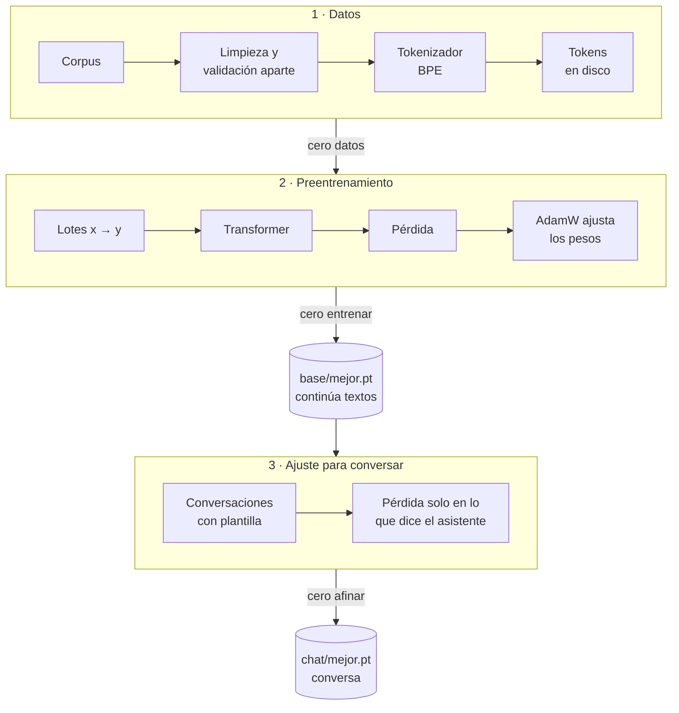
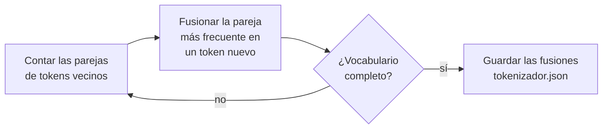
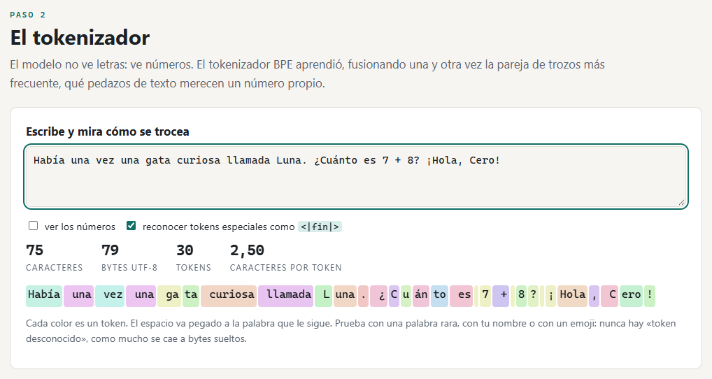
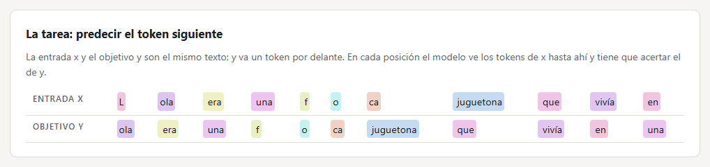
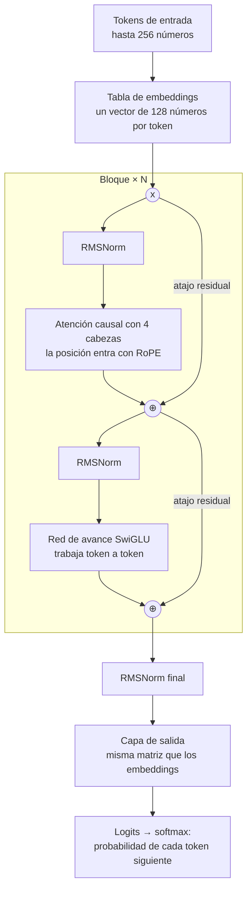
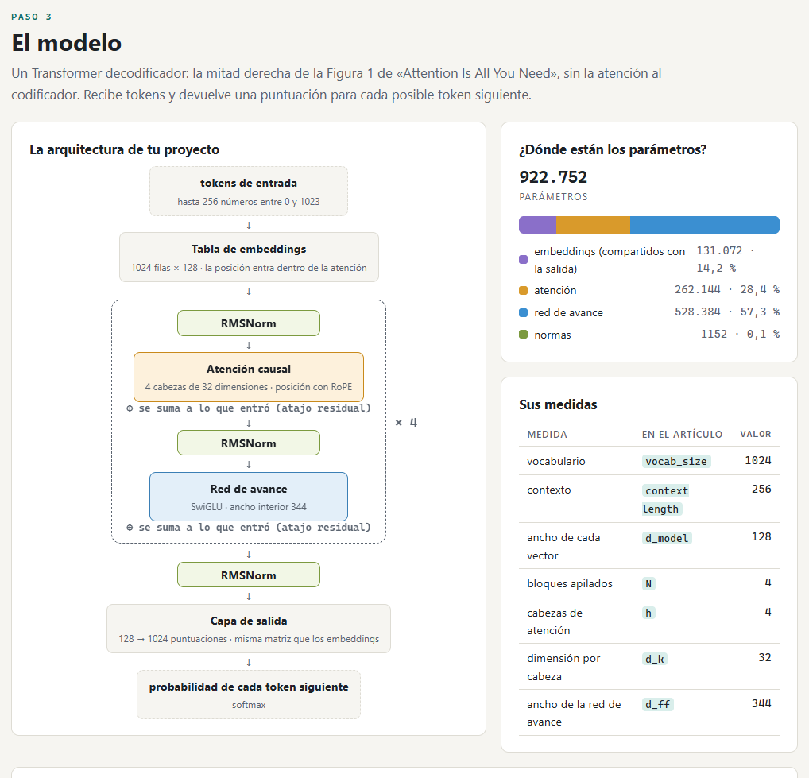
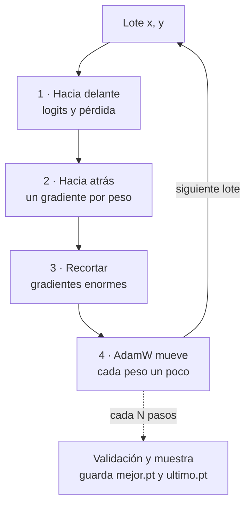
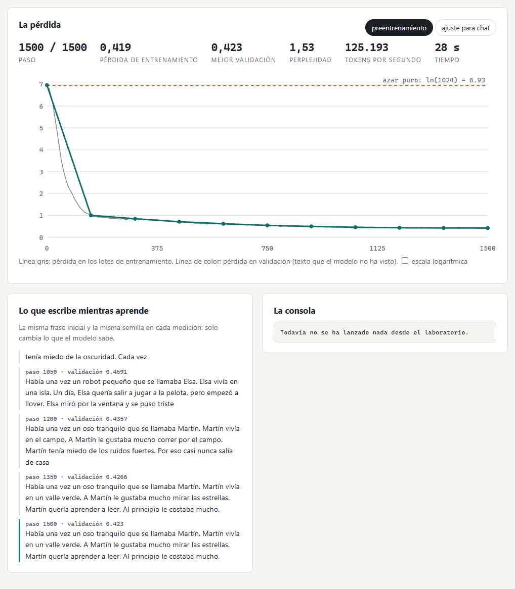
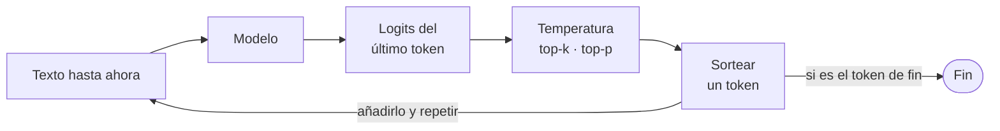
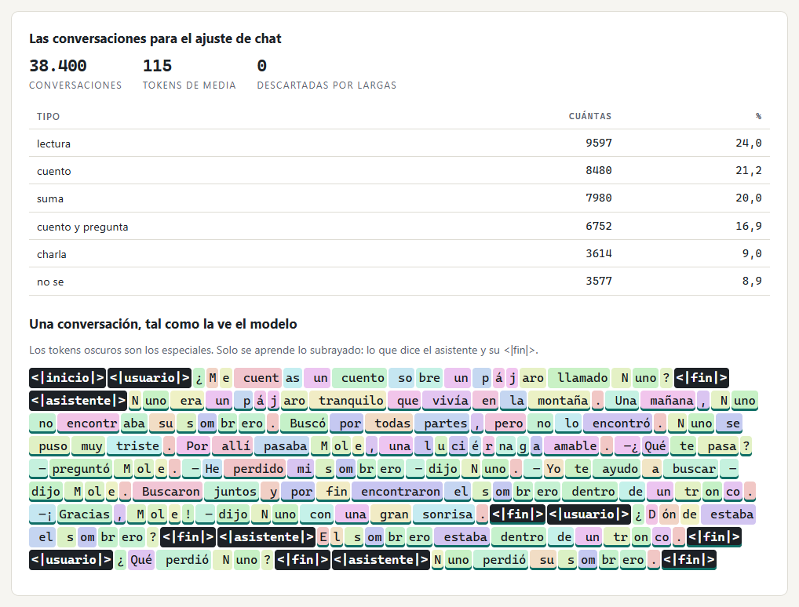

# Cómo funciona por dentro

[← Volver al README](../README.md)

Esta página recorre las piezas del proyecto en el orden en que trabajan, con un esquema de cada
una, la clase del curso que la explica y la sección del artículo
[*Attention Is All You Need*](https://arxiv.org/abs/1706.03762) (Vaswani et al., 2017) de donde sale.

## 1. El recorrido completo

Cada etapa deja sus resultados en `proyectos/<nombre>/`, así que se pueden repetir por separado.

## 2. Del texto a los números: el tokenizador (clase 1)

Un modelo no ve letras: ve números. El tokenizador **BPE a nivel de bytes**
([`cero/tokenizador.py`](../cero/tokenizador.py)) parte de los 256 valores posibles de un byte
(así que puede escribir cualquier texto: nunca hay «token desconocido») y repite:

Con 1.024 tokens aprendidos sobre los cuentos, cada token cubre de media unos 3,4 caracteres.
Además hay cuatro **tokens especiales** que nunca salen del texto normal: `<|inicio|>`,
`<|usuario|>`, `<|asistente|>` y `<|fin|>`.

*Artículo, §5.1: las frases se codificaron con byte-pair encoding.*

## 3. La tarea: predecir el token siguiente (clase 2)

No hace falta etiquetar nada: la respuesta correcta ya está en el texto, un lugar a la derecha.
La entrada `x` y el objetivo `y` son el mismo trozo de texto, desplazado un token
([`cero/datos.py`](../cero/datos.py)):

En una ventana de 256 tokens hay 256 ejercicios, y el Transformer los resuelve todos a la vez.

## 4. El modelo (clases 3 a 6)

Un **Transformer decodificador**: la mitad derecha de la Figura 1 del artículo, sin la atención
al codificador. Así es la versión moderna, la predeterminada ([`cero/modelo.py`](../cero/modelo.py)); el bloque
se repite N veces (4 en la receta `nano`):

El corazón es la **atención** (ecuación 1 del artículo): cada token compara su *consulta* con la
*clave* de todos los anteriores, convierte las puntuaciones en porcentajes y mezcla sus *valores*.
La **máscara causal** impide mirar al futuro, que es lo que permite entrenar a predecir el siguiente.

$$\text{Atención}(Q, K, V) = \operatorname{softmax}\!\left(\frac{QK^{T}}{\sqrt{d_k}}\right)V$$

### Tres generaciones con el mismo código

Los interruptores de `ConfigModelo` montan el decodificador del artículo, un GPT-2 o un modelo
actual. En la clase 12 se entrenan los tres con los mismos datos y se comparan.

| Pieza | `paper2017` | `gpt2` | `moderna` (predeterminada) |
|---|---|---|---|
| Posición | senos y cosenos (§3.5) | tabla aprendida | RoPE (rotaciones) |
| Normalización | LayerNorm, después de sumar (§3.1) | LayerNorm, antes | RMSNorm, antes |
| Red de avance | ReLU (§3.3) | GELU | SwiGLU |
| Dropout | 0,1 (§5.4) | 0 | 0 |
| Pesos de entrada y salida | compartidos (§3.4) | compartidos | compartidos |

### Del artículo al código

| Idea | Sección del artículo | Dónde está | Clase |
|---|---|---|---:|
| BPE | §5.1 | `tokenizador.py` | 1 |
| Embeddings y pesos compartidos | §3.4 | `modelo.py` → `GPT` | 3, 6 |
| Codificación posicional sinusoidal | §3.5 | `modelo.py` → `tabla_sinusoidal` | 3 |
| Atención de producto escalar escalado | §3.2.1, ec. (1) | `modelo.py` → `atencion` | 4 |
| Máscara causal del decodificador | §3.2.3 | `modelo.py` → `mascara_causal` | 4 |
| Varias cabezas | §3.2.2 | `modelo.py` → `Atencion` | 4 |
| Atajos residuales y normalización | §3.1 | `modelo.py` → `Bloque` | 5 |
| Red de avance posición a posición | §3.3 | `modelo.py` → `RedDeAvance` | 5 |
| Optimizador y tasa de aprendizaje | §5.3, ec. (3) | `entrenar.py` | 7 |
| Dropout | §5.4 | `modelo.py` | 5 |
| Búsqueda en haz frente a muestreo | §6.1 | `generar.py` | 9 |

## 5. El entrenamiento (clases 7 y 8)

Cada paso del bucle ([`cero/entrenar.py`](../cero/entrenar.py)) hace cuatro cosas, y nada más:

La tasa de aprendizaje sube en línea recta durante el calentamiento y después baja en coseno.
En GPU se calcula con precisión mixta (bfloat16). Ctrl+C pausa guardando todo, y `--reanudar`
continúa exactamente donde se quedó.

La pérdida empieza en **ln(V)** (un modelo que reparte la probabilidad por igual entre los V
tokens) y todo lo que baja de ahí es algo aprendido.

## 6. Generar texto (clase 9)

El modelo no escribe: puntúa cada token posible. Generar es repetir
([`cero/generar.py`](../cero/generar.py)):

La **caché KV** guarda las claves y los valores de los tokens ya escritos: cada token nuevo solo
calcula lo suyo, en vez de volver a procesar todo el texto.

## 7. De LLM a chatbot (clases 10 y 11)

Un chatbot es **el mismo modelo**, ajustado unos minutos más con textos en forma de conversación
([`cero/chat.py`](../cero/chat.py)). Cambian dos cosas: la **plantilla**, que marca con tokens
especiales quién habla, y la **máscara**, que hace que solo se aprenda lo que dice el asistente
(subrayado abajo) y su `<|fin|>`, que le enseña a callar al terminar.

Para conversar se escribe la conversación hasta `<|asistente|>` y el modelo continúa hasta
escribir `<|fin|>`. En cada turno relee la conversación entera; lo que no cabe en su ventana de
256 tokens, lo olvida.

### ¿Qué aprendió de verdad?

`cero evaluar` le hace preguntas **nuevas** con respuesta comprobable, incluidos nombres y sumas
que nunca vio al entrenar. Resultados típicos de la receta `nano`:

| Prueba | Aciertos |
|---|---:|
| Cuento sobre el personaje pedido | 25/25 |
| Copiar en el cuento un nombre **nunca visto** | 25/25 |
| Responder sobre un cuento dado | 14-20/25 |
| Sumas vistas al entrenar | 22-24/25 |
| Sumas **nunca vistas** | 4-8/17 |
| Decir «no lo sé» a preguntas nuevas fuera de su mundo | 5-10/10 |

Copia nombres que nunca vio (lo hace la atención), pero no sabe sumar: memorizó la tabla. La
clase 11 explica por qué, y cómo la variedad de los datos decide entre memorizar y generalizar.
