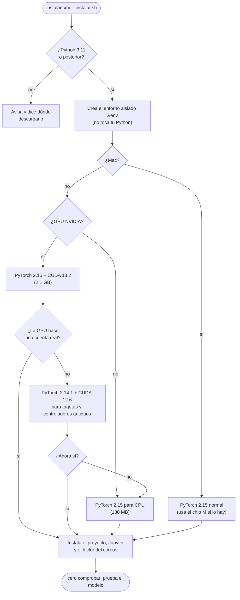

# Instalación detallada

[← Volver al README](../README.md)

## Requisitos

| | Mínimo | Recomendado |
|---|---|---|
| Sistema | Windows 10/11, Linux o macOS | — |
| Python | 3.11 | 3.12 |
| Memoria | 4 GB de RAM | 8 GB o más |
| Disco | 1,5 GB (versión CPU) | 4 GB (versión GPU, con el corpus real) |
| GPU | No hace falta | NVIDIA RTX serie 20 o posterior (o un Mac con chip M) |

## Paso a paso

### 1. Instalar Python

Descárgalo de [python.org/downloads](https://www.python.org/downloads/) (la versión 3.12 es la más
probada con este proyecto).

- **Windows:** en la primera pantalla del instalador marca **«Add python.exe to PATH»**.
- **Linux (Debian/Ubuntu):** `sudo apt install python3.12 python3.12-venv`
- **macOS:** el instalador de python.org o `brew install python@3.12`.

### 2. Descargar el proyecto

- **Sin git:** en la página del repositorio, botón verde **`<> Code` → `Download ZIP`**, y
  descomprime la carpeta donde quieras (mejor en una ruta sin caracteres raros).
- **Con git:** `git clone https://github.com/jceronch1/Crear-LLM-desde-cero.git`

### 3. Ejecutar el instalador

| Windows | Linux / macOS |
|---|---|
| Doble clic en `instalar.cmd` | En una terminal, dentro de la carpeta: `sh instalar.sh` |

Tarda de 2 a 10 minutos según la conexión (la versión GPU descarga 2,1 GB). Al final aparece
«Instalación terminada» y una comprobación del modelo.

## Qué hace el instalador



Se puede ejecutar todas las veces que haga falta: lo que ya está instalado no se repite.

| Opción | Para qué |
|---|---|
| `--cpu` | Instalar la versión para CPU aunque haya GPU (descarga mucho más pequeña) |
| `--gpu` | Exigir GPU: si no se consigue, falla en vez de instalar la versión CPU |
| `--sin-curso` | No instalar Jupyter ni matplotlib |
| `--reinstalar` | Volver a instalar PyTorch aunque ya esté |
| `--con-pip` | Usar `pip` aunque esté instalado `uv` |

En Windows se pasan igual: `instalar.cmd --cpu`.

## Comprobar que todo funciona

```bash
.\cero comprobar          # Windows
./cero.sh comprobar       # Linux / macOS
```

Dice qué se usará para calcular (CPU o GPU), comprueba el modelo y **mide cuánto tardará cada
receta en tu equipo**. Para comprobarlo todo a fondo están las pruebas automáticas (unos 3 minutos):

```bash
.venv\Scripts\python -m pytest -q          # Windows
.venv/bin/python -m pytest -q              # Linux / macOS
```

## Tres formas de usar la orden `cero`

| | Windows | Linux / macOS |
|---|---|---|
| Lanzador (desde la carpeta del proyecto) | `.\cero chat` | `./cero.sh chat` |
| Activando el entorno | `.venv\Scripts\activate` y luego `cero chat` | `source .venv/bin/activate` y luego `cero chat` |
| Menú de doble clic | `menu.cmd` | — |

Los mensajes de la herramienta escriben las órdenes con la forma del lanzador de tu sistema, para
que se puedan copiar tal cual.

## Abrir el curso

`cero curso` abre JupyterLab con las 13 clases y el entorno correcto ya elegido.

Si prefieres **VS Code**: abre la carpeta del proyecto, abre un `.ipynb` del directorio `curso/` y,
arriba a la derecha («Select Kernel»), elige el Python de **`.venv`**. Si eliges otro Python, la
primera celda dará `No module named 'cero'`.

## Forzar la CPU

Con la variable de entorno `CERO_DISPOSITIVO=cpu`, todo lo que normalmente elegiría la GPU usa la
CPU (útil para que todos los ordenadores de un aula den los mismos resultados). Para una orden
concreta basta con `--dispositivo cpu`.

## Problemas frecuentes

| Síntoma | Solución |
|---|---|
| `instalar.cmd` dice que no encuentra Python | Instala Python 3.12 marcando «Add python.exe to PATH» y vuelve a ejecutarlo |
| En PowerShell, `cero` «no se reconoce» | Escribe `.\cero` (PowerShell no busca en la carpeta actual) |
| `./cero.sh: Permission denied` (Linux/macOS) | Usa `sh cero.sh ...` o da permiso una vez: `chmod +x cero.sh instalar.sh` |
| Tengo GPU NVIDIA pero se usa la CPU | `cero comprobar` lo indica. Casi siempre es un controlador antiguo: actualízalo desde nvidia.com y ejecuta `instalar.cmd --reinstalar` |
| Acentos raros en la consola de Windows | Usa `.\cero` o `menu.cmd`, que activan UTF-8 |
| Sin internet en el aula | La receta `nano` y todo el curso funcionan sin conexión. Para `micro`, `mini` y `base`, copia la carpeta `descargas/` de un equipo donde ya se descargó el corpus |
| La descarga del corpus se corta | Repite la orden: continúa donde se quedó. Si el archivo llega dañado se detecta y se descarga de nuevo |
| «CUDA out of memory» con la receta `base` | Necesita una GPU con 8 GB libres. Baja `lote` en `proyectos/<nombre>/config.json` |

## Desinstalar

Todo vive dentro de la carpeta del proyecto (el entorno en `.venv`, los modelos en `proyectos/`,
el corpus en `descargas/`). Para desinstalar basta con borrar la carpeta.
